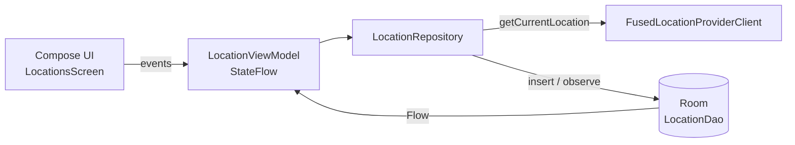

# Offline Location Tracker

An offline-first Android app that reads the device location, stores every point in a local **Room** database and shows the history. The UI only observes the database, so the app keeps working without internet: Room is the **single source of truth**.

> Lab #9 · Mobile Application Development course. Ukrainian version: [README.uk.md](README.uk.md)

## Features

- Runtime location permission flow
- Current position via `FusedLocationProviderClient`: latitude, longitude, accuracy
- History list that updates automatically through Kotlin `Flow`
- Clear all saved points
- Works offline: everything is read from the local cache

## Architecture

| Layer | Classes |
|---|---|
| UI | `LocationsScreen`, `PermissionsFlow` (Jetpack Compose) |
| State | `LocationViewModel` exposing `StateFlow` |
| Data | `LocationRepository`, `LocationDao`, `LocationEntity`, `AppDatabase` |
| DI | Hilt: `LocationApp`, `AppModule` |

## Tech stack

Kotlin · Coroutines & Flow · Jetpack Compose · Room · Google Play Services Location · Hilt

## Run locally

1. Open the project in Android Studio (Ladybug or newer) and let Gradle sync
2. Run on a device or an emulator with Google Play Services
3. Grant location permission and tap **Отримати позицію** (Get position) to save the current point
